<p align="center">
  
</p>

<p align="center">
  <b>Skill swap, not skill shop.</b><br/>
  <b>SkillSync</b> is a peer-to-peer skill-swapping platform where people <b>trade knowledge instead of money</b>.<br/>
  Tell us what you can teach and what you want to learn, get matched with a partner whose skills complement yours, and schedule a session — <b>completely free</b>.
</p>

<p align="center">
  <a href="https://skill-sync-edu.vercel.app/">
    
  </a>
  &nbsp;
  <a href="https://skill-sync-edu.vercel.app/">
    
  </a>
</p>

<a name="contents"></a>


<p align="center">
  <a href="#about">About</a> ·
  <a href="#how-it-works">How it works</a> ·
  <a href="#features">Features</a> ·
  <a href="#try-it-live">Try it live</a> ·
  <a href="#tech-stack">Tech stack</a> ·
  <a href="#quick-start">Quick start</a> ·
  <a href="#scripts">Scripts</a> ·
  <a href="#project-structure">Project structure</a> ·
  <a href="#deploy">Deploy</a> ·
  <a href="#contributing">Contributing</a> ·
  <a href="#troubleshooting">Troubleshooting</a> ·
  <a href="#credits">Credits</a>
</p>

<a name="about"></a>


Learning is often expensive. **SkillSync** is built on the idea that everyone has something to teach and something to learn. You list the skills you can teach and the skills you want to learn, SkillSync matches you with people whose skills complement yours, and then you schedule a session. No money involved.

> **Learn something new, teach something you know.**
> There are no fees for learning something new. Just trade a skill you have for one you want.

<p align="center">
  
</p>

- 🌐 **Live app:** https://skill-sync-edu.vercel.app/
- 📦 **Repository:** https://github.com/AkkhileshCod3s/SkillSync
- 💸 **Free forever** — no credit card required
- 👀 **Browse first** — explore profiles before you even sign up

<a name="how-it-works"></a>


1. **List your skills** — what you can teach and what you want to learn.
2. **Get matched** — find a partner whose skills complement yours.
3. **Schedule a session** — pick a time and learn from each other, completely free.

> 💡 **Tip:** You can browse profiles in **Explore** before you start. Sign up later.

<a name="features"></a>
<p align="center">
  
</p>

- **Peer-to-peer learning** — people teach each other, with no middleman.
- **Completely free** — knowledge in exchange for knowledge, never money.
- **Skill matching** — complementary partners based on your teach and learn lists.
- **Session scheduling** — book a session once you are matched.
- **Browse before you sign up** — look at profiles first, then decide.

**Tabs inside the app** (from the navbar):

| Tab | What it is |
|---|---|
| **Explore** | Browse profiles of people you can learn from |
| **Connections** | Keep track of the people you connect with in one place |
| **Sessions** | Your learning sessions |
| **Learning Plan** | Plan what you want to learn next |

<a name="try-it-live"></a>


The app is live at **https://skill-sync-edu.vercel.app/**. Open it, browse a few profiles, and create your own when you are ready. No credit card needed.

<a name="tech-stack"></a>


| Area | Choice |
|---|---|
| Build tool | [Vite](https://vitejs.dev/) 5 (`@vitejs/plugin-react`) |
| UI | [React](https://react.dev/) 18 |
| Routing | [React Router](https://reactrouter.com/) 6 (`react-router-dom`) |
| Icons | [Lucide](https://lucide.dev/) (`lucide-react`) |
| Fonts | Instrument Serif + Inter (Google Fonts) |
| Language | JavaScript (ES modules) |
| Hosting | [Vercel](https://vercel.com/) |

<a name="quick-start"></a>


**Prerequisites:** Node.js 18+ and npm.

```bash
# 1. Clone
git clone https://github.com/AkkhileshCod3s/SkillSync.git

# 2. Enter the project
cd SkillSync

# 3. Install dependencies
npm install

# 4. Start the dev server
npm run dev      # http://localhost:5173
```

Open `http://localhost:5173` in your browser and the app is ready.

<a name="scripts"></a>


| Command | What it does |
|---|---|
| `npm run dev` | Starts the Vite dev server (with hot reload) |
| `npm run build` | Creates a production build in `dist/` |
| `npm run preview` | Serves the production build locally |

<a name="project-structure"></a>


```
SkillSync/
├── dist/            → production build output
├── public/          → static assets (favicons etc.)
├── src/             → React app source (entry: src/main.jsx)
├── index.html       → Vite entry HTML (loads fonts + /src/main.jsx)
├── package.json     → scripts + dependencies
├── package-lock.json
├── vite.config.js   → Vite configuration
└── .gitignore
```

<a name="deploy"></a>


The app is a static Vite build and is live on **Vercel**: https://skill-sync-edu.vercel.app/

**Deploying to Vercel**
1. Import the repo into Vercel.
2. Framework preset: **Vite**.
3. Build command: `npm run build`, output directory: `dist`.

> Because React Router is used, a direct link to a page (or a refresh) may return a 404. To fix that, rewrite all routes to `index.html`. Create a `vercel.json` in the project root:
>
> ```json
> {
>   "rewrites": [{ "source": "/(.*)", "destination": "/index.html" }]
> }
> ```

<a name="contributing"></a>


1. **Fork** the repo and clone it.
2. Create a new branch: `git switch -c my-feature`
3. Make your changes and run `npm run build` to check that the build passes.
4. Commit and open a **Pull Request**.

Found a bug or have an idea? Let us know in [Issues](https://github.com/AkkhileshCod3s/SkillSync/issues).

<a name="troubleshooting"></a>


| Problem | Fix |
|---|---|
| Port `5173` is busy | Run `npm run dev -- --port 3000`, or stop the other process. |
| `npm install` or the build fails | Use Node.js 18+, then delete `node_modules` and run `npm install` again. |
| A page link returns 404 on the deployed site | Add the `vercel.json` rewrite rule to the project root (see the [Deploy](#deploy) section above). |

<a name="credits"></a>


- Fonts: **Instrument Serif** and **Inter** via Google Fonts.
- Icons: [Lucide](https://lucide.dev/).
- Built with Vite, React and React Router; hosted on Vercel.
- Made by [@AkkhileshCod3s](https://github.com/AkkhileshCod3s).

<p align="center">
  
</p>