<p align="center">
  
</p>

<p align="center">
  <b>Skill swap, not skill shop.</b><br/>
  <b>SkillSync</b> ek peer-to-peer skill-swapping platform hai jahan log <b>paise ki jagah knowledge trade karte hain</b>.<br/>
  Batao tum kya sikha sakte ho aur kya seekhna chahte ho, aisa partner pao jiski skills tumhari skills ko complement kare, aur session schedule karo — <b>bilkul free</b>.
</p>

<p align="center">
  <sub>free forever · no credit card · browse before you sign up</sub>
</p>

<p align="center">
  <a href="https://skill-sync-edu.vercel.app/">
    
  </a>
</p>

<p align="center">
  
  
  
  
  
  
</p>

<a name="contents"></a>


<p align="center">
  <a href="#about">About</a> ·
  <a href="#how-it-works">How it works</a> ·
  <a href="#features">Features</a> ·
  <a href="#tech-stack">Tech stack</a> ·
  <a href="#quick-start">Quick start</a> ·
  <a href="#scripts">Scripts</a> ·
  <a href="#project-structure">Project structure</a> ·
  <a href="#deploy">Deploy</a> ·
  <a href="#contributing">Contributing</a> ·
  <a href="#troubleshooting">Troubleshooting</a> ·
  <a href="#credits">Credits</a>
</p>

<p align="center"></p>

<a name="about"></a>


<p align="center">
  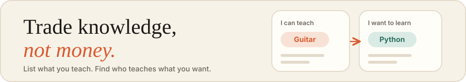
</p>

Aaj ke time mein seekhna aksar mehenga hota hai. **SkillSync** is idea par bana hai ki har kisi ke paas kuch sikhane ko hota hai aur kuch seekhne ko bhi. Tum apni skills list karte ho (jo sikha sakte ho) aur woh skills bhi (jo seekhna chahte ho), SkillSync tumhe aise logon se match karta hai jinki skills tumhari skills ko complement karti hain, aur phir tum ek session schedule kar lete ho. Paise ka koi lena-dena nahi.

> **Learn something new, teach something you know.**
> Kuch naya seekhne ke liye koi fees nahi — bas apni ek skill do, badle mein jo skill chahiye wo lo.

- 🌐 **Live app:** https://skill-sync-edu.vercel.app/
- 📦 **Repository:** https://github.com/AkkhileshCod3s/SkillSync
- 💸 **Free forever** — koi credit card nahi chahiye
- 👀 **Browse first** — profiles sign up karne se pehle bhi explore kar sakte ho

<a name="how-it-works"></a>


<p align="center">
  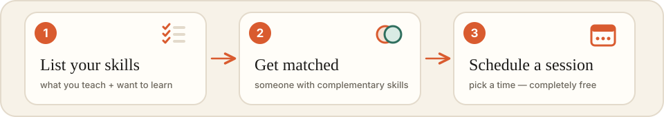
</p>

1. **List your skills** — jo tum sikha sakte ho aur jo seekhna chahte ho.
2. **Get matched** — aise partner se match ho jiski skills tumhari skills ko complement karti hain.
3. **Schedule a session** — time fix karo aur ek-dusre se seekho, completely free.

> 💡 **Tip:** shuru karne se pehle **Explore** mein profiles dekh sakte ho, sign up baad mein karo.

<a name="features"></a>


<p align="center">
  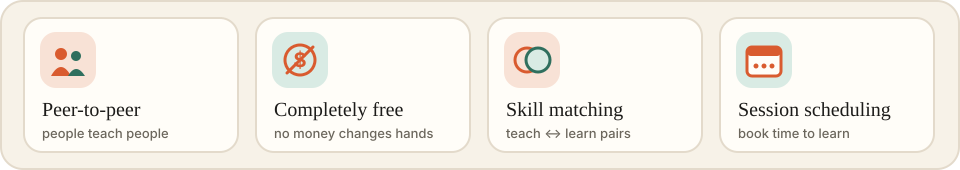
</p>

- **Peer-to-peer learning** — log ek-dusre ko sikhate hain, koi middleman nahi.
- **Completely free** — knowledge ke badle knowledge, paisa nahi.
- **Skill matching** — teach aur learn lists ke basis par complementary partners.
- **Session scheduling** — match hone ke baad session book karo.
- **Browse before you sign up** — pehle profiles dekho, phir decide karo.

**App ke andar ke tabs** (navbar se):

| Tab | Kya hai |
|---|---|
| **Explore** | Aise logon ke profiles browse karo jinse tum seekh sakte ho |
| **Connections** | Jin logon se tum connect ho unhe ek jagah track karo |
| **Sessions** | Tumhare learning sessions |
| **Learning Plan** | Apna agla learning plan banao |

<a name="tech-stack"></a>


<p align="center">
  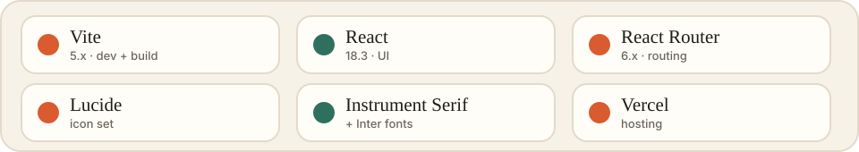
</p>

| Area | Choice |
|---|---|
| Build tool | [Vite](https://vitejs.dev/) 5 (`@vitejs/plugin-react`) |
| UI | [React](https://react.dev/) 18 |
| Routing | [React Router](https://reactrouter.com/) 6 (`react-router-dom`) |
| Icons | [Lucide](https://lucide.dev/) (`lucide-react`) |
| Fonts | Instrument Serif + Inter (Google Fonts) |
| Language | JavaScript (ES modules) |
| Hosting | [Vercel](https://vercel.com/) |

<a name="quick-start"></a>


<p align="center">
  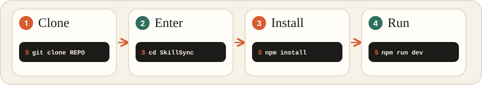
</p>

**Prerequisites:** Node.js 18+ aur npm.

```bash
# 1. Clone
git clone https://github.com/AkkhileshCod3s/SkillSync.git

# 2. Enter the project
cd SkillSync

# 3. Install dependencies
npm install

# 4. Start the dev server
npm run dev      # http://localhost:5173
```

Browser mein `http://localhost:5173` kholo — app ready hai.

<a name="scripts"></a>


<p align="center">
  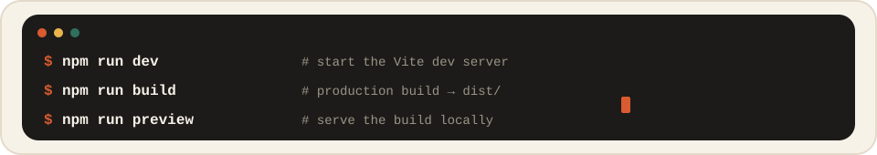
</p>

| Command | Kya karta hai |
|---|---|
| `npm run dev` | Vite dev server chalata hai (hot reload ke saath) |
| `npm run build` | Production build `dist/` mein banata hai |
| `npm run preview` | Production build ko locally serve karta hai |

<a name="project-structure"></a>


<p align="center">
  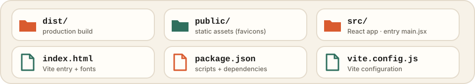
</p>

```
SkillSync/
├── dist/            → production build output
├── public/          → static assets (favicons etc.)
├── src/             → React app source (entry: src/main.jsx)
├── index.html       → Vite entry HTML (loads fonts + /src/main.jsx)
├── package.json     → scripts + dependencies
├── package-lock.json
├── vite.config.js   → Vite configuration
└── .gitignore
```

<a name="deploy"></a>


<p align="center">
  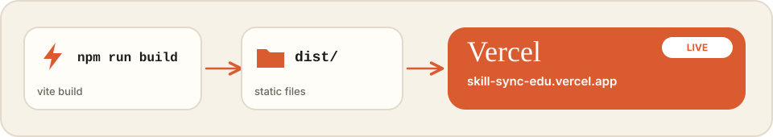
</p>

App ek static Vite build hai, aur **Vercel** par live hai: https://skill-sync-edu.vercel.app/

**Vercel par deploy karna**
1. Repo ko Vercel mein import karo.
2. Framework preset: **Vite**.
3. Build command: `npm run build`, output directory: `dist`.

> React Router use ho raha hai, isliye agar kisi page ka direct link (refresh par) 404 de, to saare routes ko `index.html` par rewrite karo. Vercel par root mein `vercel.json` banao:
>
> ```json
> {
>   "rewrites": [{ "source": "/(.*)", "destination": "/index.html" }]
> }
> ```

<a name="contributing"></a>


<p align="center">
  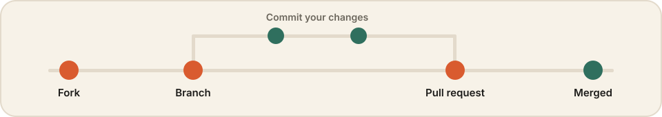
</p>

1. Repo ko **fork** karo aur clone karo.
2. Naya branch banao: `git switch -c my-feature`
3. Changes karo aur `npm run build` chalake check karo ki build pass hota hai.
4. Commit karo aur **Pull Request** kholo.

Bug ya idea ho to [Issues](https://github.com/AkkhileshCod3s/SkillSync/issues) mein batao.

<a name="troubleshooting"></a>


<p align="center">
  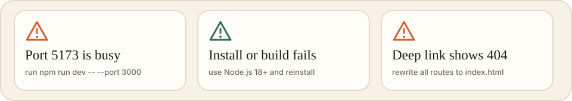
</p>

| Problem | Fix |
|---|---|
| Port `5173` busy hai | `npm run dev -- --port 3000` chalao ya dusra process band karo. |
| `npm install` ya build fail ho raha hai | Node.js 18+ use karo, phir `node_modules` delete karke `npm install` dobara chalao. |
| Deployed site par kisi page ka link 404 deta hai | Root mein `vercel.json` rewrite rule add karo (upar [Deploy](#deploy) section mein diya hai). |

<a name="credits"></a>


<p align="center">
  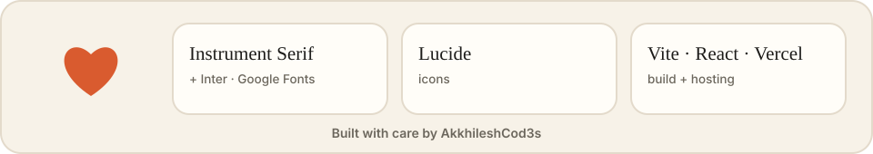
</p>

- Fonts: **Instrument Serif** aur **Inter** via Google Fonts.
- Icons: [Lucide](https://lucide.dev/).
- Built with Vite, React aur React Router; hosted on Vercel.
- Made by [@AkkhileshCod3s](https://github.com/AkkhileshCod3s).

<p align="center"></p>

<p align="center">
  <sub>Swap skills, grow together. 🌱</sub>
</p>